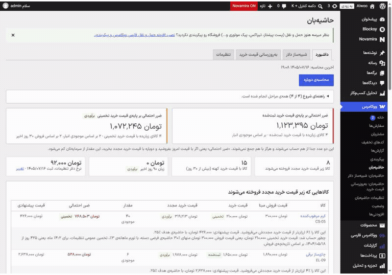
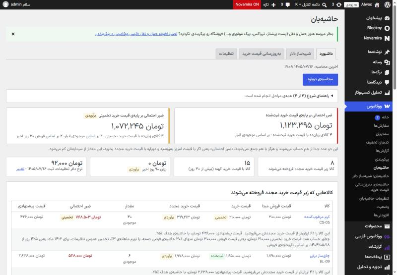
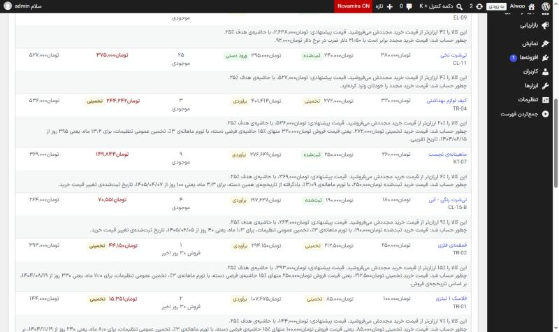
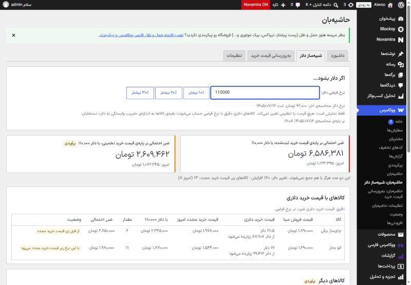
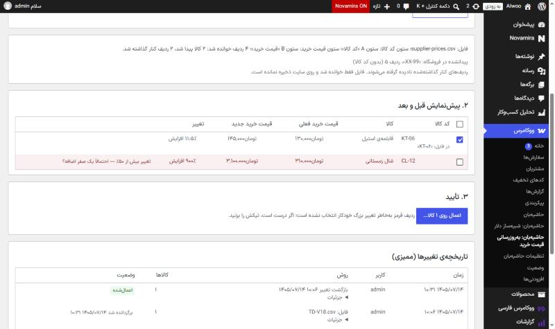
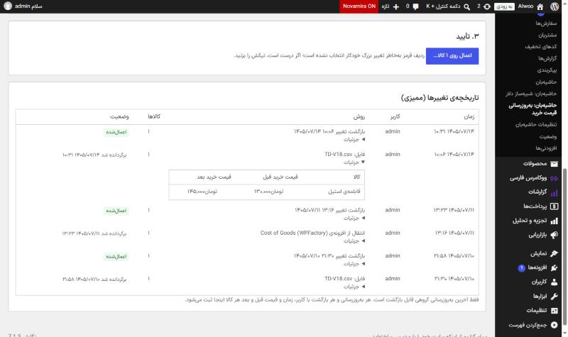
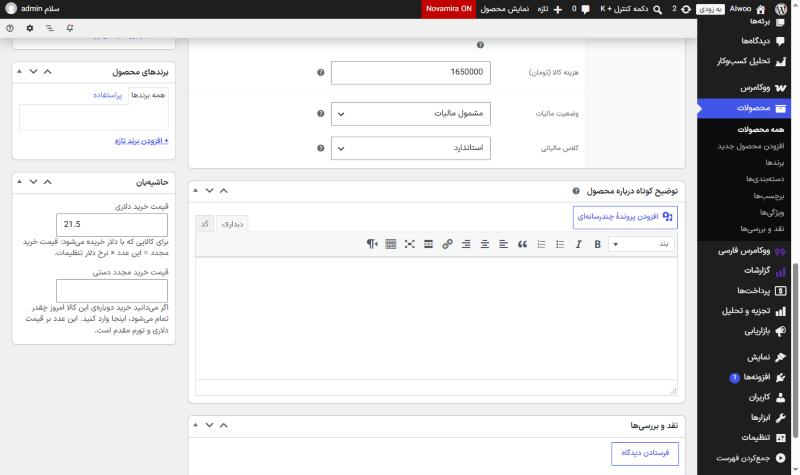

<div dir="rtl">

# حاشیه‌بان — محافظ سود فروشگاه‌های ووکامرس

> **دیگر زیر قیمتِ خریدِ دوباره نفروشید.**
> افزونه‌ای برای فروشگاه‌های ووکامرس ایرانی که به تومان نشان می‌دهد وقتی تورم قیمت خرید مجدد را از قیمت فروش بالاتر برده، چقدر سرمایه بی‌صدا از دست می‌رود.

🇬🇧 **[English version of this document](README.md)**



**وضعیت:** نسخه‌ی 1.0.5، آماده‌ی انتشار و آزموده · **سازنده:** [شاهین پارسا](https://www.linkedin.com/in/shahin-parsa/) · **کد منبع:** خصوصی (محصول تجاری). این مخزن یک ویترین است: محصول چه می‌کند، چطور ساخته شده و کیفیتش چطور ثابت شده است.

---

## مشکل

در اقتصاد پرتورم، فروشگاه‌داری کالایی را ماه‌ها پیش ۸۵ هزار تومان خریده و هنوز ۱۰۰ هزار تومان می‌فروشد. ظاهراً ۱۵٪ سود دارد. ولی خرید همان کالا **امروز** حدود ۱۰۷٬۷۰۰ تومان تمام می‌شود. هر فروش، سرمایه‌ی لازم برای خرید دوباره را کوچک‌تر می‌کند و هیچ‌چیز در ووکامرس این را نشان نمی‌دهد.

بیشتر فروشگاه‌های کوچک اصلاً قیمت خرید را ثبت نمی‌کنند، پس حتی نمی‌توانند این عدد را حساب کنند.

## حاشیه‌بان چه می‌کند

| امکان | چیزی که فروشگاه‌دار می‌گیرد |
|---|---|
| **داشبورد ضرر احتمالی** | دو عدد جدا: بر پایه‌ی قیمت خرید ثبت‌شده و بر پایه‌ی قیمت خرید تخمینی. این دو هرگز با هم جمع نمی‌شوند تا عدد قطعی و عدد تخمینی قاطی نشوند. کالاها به ترتیب ضرر مرتب‌اند و زیر هر کدام «چطور حساب شد» به زبان ساده آمده است. |
| **کار بدون هیچ داده‌ای** | با وارد کردن یک «حاشیه‌ی فرضی» برای هر دسته، اولین عدد در چند دقیقه ساخته می‌شود. لازم نیست اول قیمت خرید کالاها ثبت شود. |
| **قیمت خرید مجدد، سه روش** | تورم ماهانه که **از تاریخچه‌ی قیمت خرید خود فروشگاه یاد گرفته می‌شود** · قیمت دلاری × نرخ دلار · عدد دستی. |
| **شبیه‌ساز «اگر دلار بشود…»** | محاسبه‌ی فوری در مرورگر روی داده‌ی کش‌شده. برای هر کالای دلاری می‌گوید از چه نرخی زیان‌ده می‌شود. |
| **قیمت پیشنهادی و فایل CSV** | با حاشیه‌ی هدف، گام گرد کردن و «ختم به ۹» اختیاری. فقط نمایش و دانلود؛ هرگز قیمت فروش را تغییر نمی‌دهد. |
| **به‌روزرسانی گروهی قیمت خرید** | درصدی، دلاری × نرخ، از **فایل اکسل یا CSV تأمین‌کننده** (با ارقام فارسی در کد کالا و قیمت)، یا انتقال از سه افزونه‌ی دیگر. همیشه پیش‌نمایش ← تأیید صریح ← تاریخچه ← بازگشت با یک کلیک. |
| **گزارش سود ۹۰ روز اخیر** | کالاهای زیان‌ده، جمع‌ها و کامل بودن داده‌ی قیمت خرید، با تاریخ شمسی. |

<table>
<tr>
<td></td>
<td></td>
</tr>
<tr>
<td align="center"><sub>داشبورد: ضرر ثبت‌شده و تخمینی، هرگز جمع نمی‌شوند</sub></td>
<td align="center"><sub>هر عدد خودش را توضیح می‌دهد</sub></td>
</tr>
<tr>
<td></td>
<td></td>
</tr>
<tr>
<td align="center"><sub>«اگر دلار بشود ۱۱۰٬۰۰۰؟»</sub></td>
<td align="center"><sub>فایل تأمین‌کننده: تغییر مشکوک ۹۰۰٪ قرمز و تیک‌نخورده</sub></td>
</tr>
</table>

## چرا متفاوت است

افزونه‌های قیمت خرید ووکامرس (نمونه‌های شناخته‌شده‌ی WordPress.org و گزارش‌های سود تجاری) یک پرسش را جواب می‌دهند: «روی سفارش‌های گذشته چقدر سود کردم؟» قیمت خرید ثبت‌شده را از قیمت فروش کم می‌کنند. در بازار پرتورم این جواب دلگرم‌کننده و غلط است، چون قیمتی که اهمیت دارد آن چیزی نیست که پرداخته‌اید، بلکه چیزی است که **برای خرید دوباره** خواهید پرداخت.

حاشیه‌بان حول پرسش دوم ساخته شده است. تا جایی که من می‌دانم، هیچ افزونه‌ی ووکامرسی این‌ها را انجام نمی‌دهد:

| | افزونه‌های معمول قیمت خرید و سود | حاشیه‌بان |
|---|---|---|
| **عددی که گزارش می‌کند** | سود گذشته روی قیمت خرید ثبت‌شده | **از دست رفتن سرمایه در آینده** با قیمت خرید مجدد امروز، به تومان |
| **فروشگاه بدون قیمت خرید** | تا همه‌ی قیمت‌ها وارد نشود چیزی نشان نمی‌دهد | **از روز اول کار می‌کند:** یک حاشیه‌ی فرضی برای هر دسته، قیمت خرید تخمینی می‌سازد؛ با برچسب روشن، و با رسیدن قیمت واقعی خودکار جایگزین می‌شود |
| **تورم** | مدل نمی‌شود | **از تاریخچه‌ی خود فروشگاه یاد گرفته می‌شود:** میانه‌ی نرخ ماهانه‌ی کالاهایی که قیمت خریدشان با دست‌کم ۶۰ روز فاصله عوض شده (دست‌کم ۳ کالا در هر دسته)، با پیش‌فرض و برچسب شفاف |
| **«این قیمت از کِی کهنه است؟»** | پرسیده نمی‌شود | **تشخیص‌دهنده‌ی سه‌مرحله‌ای تاریخ مبنا:** دفتر قیمت خرید خود افزونه ← تاریخچه‌ی فروش (قدیمی‌ترین فروش در رشته‌ی پیوسته‌ی قیمت فعلی، تا ۲۴ ماه عقب) ← تاریخ ساخت کالا؛ هر کدام با برچسب خودش |
| **عدد قطعی و تخمینی** | در یک جمع قاطی می‌شوند | **دو جمع که هرگز با هم جمع نمی‌شوند**، در هر صفحه و هر خروجی. کلمه‌ی «قطعی» هیچ‌جا نیست. |
| **ریسک ارز** | هیچ، یا یک نرخ ثابت | **شبیه‌ساز «اگر دلار بشود…»** در مرورگر، به‌علاوه‌ی نرخ دقیقی که هر کالا از آن زیان‌ده می‌شود |
| **تغییر گروهی قیمت خرید** | نوشتن مستقیم، بدون برگشت | **پیش‌نمایش ← تأیید صریح ← تاریخچه ← بازگشت با یک کلیک**، با هشدار تغییر بیش از ۵۰٪، پیش‌نمایش امضاشده با اعتبار ۱۲ ساعت، و فهرست سفارش‌هایی که بین تغییر و بازگشت ثبت شده‌اند |
| **صداقت رابط کاربری** | عدد بدون منشأ | زیر هر ردیف یک جمله‌ی **«چطور حساب شد»** به فارسی ساده، بدون فرمول و توان |

ریزه‌کاری‌هایی که فروشگاه‌دار ایرانی فوراً متوجهشان می‌شود:

- **ارقام فارسی، عربی و انگلیسی همه پذیرفته می‌شوند**، پس فایل اکسل تأمین‌کننده با «KT-۰۶» به کالای «KT-06» می‌رسد.
- **تقویم شمسی داخلی** (الگوریتم نجومی، روز به روز با ICU برای سال‌های ۱۳۵۰ تا ۱۴۵۰ بررسی شده)، پس تاریخ‌ها حتی با افزونه‌های تبدیل تاریخ هم درست می‌مانند.
- مبلغ‌ها با ارز خود فروشگاه (تومان، ریال) نمایش داده می‌شوند و افزونه هیچ تبدیلی انجام نمی‌دهد.
- **انتقال از سه افزونه‌ی دیگر قیمت خرید**، بدون دست زدن یا پاک کردن داده‌ی آن‌ها.

## نکات برجسته‌ی مهندسی

محصول روی سطح کوچک است و زیر سطح عمداً عمیق. این‌ها بخش‌هایی است که بیشتر به آن‌ها می‌بالم.

**درستی زیر خطا.** هر به‌روزرسانی گروهی به شکل یک *طرح ثابت* ذخیره می‌شود: برای هر کالا، قیمتی که در پیش‌نمایش دیده شده و قیمتی که باید نوشته شود. یک ردیف فقط وقتی نوشته می‌شود که قیمت فعلی‌اش هنوز با «قبل» طرح برابر باشد. اگر افزونه‌ی دیگری بعد از ذخیره‌ی ووکامرس خطا بدهد، تلاش دوباره مقدار جدید را می‌بیند و فقط ردیف ممیزی جامانده را اضافه می‌کند. همین طرح، پیش‌نمایش کهنه در یک تب دیگر را بی‌خطر می‌کند. هیچ سناریوی «دو بار اعمال» از مجموعه‌ی تست‌ها جان سالم به در نمی‌برد.

**احترام به رفتار خود ووکامرس.** افزونه قیمت خرید خامِ تنوع را می‌خواند نه ارث‌برده را، پس بازگشت می‌تواند ارث بردن را برگرداند. تنوع‌هایی که قیمتشان به قیمت مادر *اضافه* می‌شود کنار گذاشته و نام برده می‌شوند. پیش از ذخیره، اعتبارسنجی خود ووکامرس روی شیء اجرا می‌شود و هر ردیفی که ذخیره‌ی فقط‌قیمتش وضعیت موجودی را عوض می‌کرد رد می‌شود؛ این یک اثر جانبی ووکامرس است که در غیر این صورت کالا را از فروشگاه پنهان می‌کرد. هر یک از این رفتارها با خواندن کد منبع ووکامرس پیدا شده، با شماره‌ی فایل و خط مستند شده و با یک تست ثابت شده است.

**فروشگاه‌های بزرگ بدون قطع شدن.** محاسبه‌ها و نوشتن‌های گروهی کارهای ادامه‌پذیرند: مرحله‌های حداکثر ده‌ثانیه‌ای، قفل پایگاه داده به همان روشی که هسته‌ی وردپرس قفل به‌روزرسانی می‌سازد، پیشرفت در گزینه‌های کوچک، و دکمه‌ی لغو برای کارهای نیمه‌تمام. شبیه‌ساز دلار هرگز به سرور نمی‌رسد: روی ردیف‌های کش‌شده در مرورگر اجرا می‌شود، پس ۱۰ هزار کالا فوری شبیه‌سازی می‌شوند.

**خواننده‌ی اکسل مقاوم، بدون هیچ وابستگی.** فایل تأمین‌کننده فقط با `ZipArchive` و `XMLReader` خود PHP خوانده می‌شود: فقط اولین کاربرگ و جدول رشته‌های مشترک، با شمارش حجم هنگام خواندن (پس سرآیند جعلی zip کمکی نمی‌کند)، رد کردن DOCTYPE و موجودیت خارجی، بدون دسترسی شبکه، با سقف اندازه‌ی هر سلول و تعداد سلول‌ها. فایل از محل موقت PHP خوانده می‌شود و هرگز جابه‌جا، کپی یا نگه داشته نمی‌شود.

**امنیت به‌عنوان ویژگی، نه چک‌لیست.** هر صفحه سمت سرور با سطح دسترسی محافظت می‌شود؛ هر نوشتن به nonce **و** دو سطح دسترسی **و** حق ویرایش همان کالا نیاز دارد؛ داده‌ی اسکریپت‌های درون‌خطی با پرچم‌های امن HTML به JSON تبدیل می‌شود؛ خروجی CSV در برابر تزریق فرمول خنثی می‌شود؛ SQL فقط روی جدول‌های خود افزونه و با عبارت آماده. یک تست اثرانگشت کل پایگاه داده ثابت می‌کند که دیدن، محاسبه و همه‌ی مسیرهای نوشتن جز قیمت خرید و جدول‌های خود افزونه چیزی را عوض نمی‌کنند. سه بازبینی مستقل و ۹۵ حمله‌ی زنده روی سایت یک‌بارمصرف هیچ ایراد قابل سوءاستفاده‌ای در نسخه‌ی منتشرشده پیدا نکردند.

**سازگاری قابل اعتماد.** یک ماتریس تست کل مجموعه را روی قدیمی‌ترین پشته‌ی پشتیبانی‌شده (PHP 7.4، وردپرس 6.7، ووکامرس 10.3) و جدیدترین (PHP 8.3، وردپرس 7.1، ووکامرس 11.2) اجرا می‌کند، هر کدام با هر دو روش ذخیره‌ی سفارش. وقتی ووکامرس 11.2 یک روز پیش از انتشار شکل نمایش قیمت را عوض کرد، ماتریس در چند ساعت آن را گرفت و اصلاح همان روز منتشر شد.

## معماری و منطق

```
هسته‌ی ووکامرس (کالا، سفارش، قیمت خرید)              حاشیه‌بان
────────────────────────────────────────────         ──────────────────────────────────────────────
CRUD API: wc_get_products / wc_get_orders  ──خواندن──▶  هسته‌ی محاسبه (PHP خالص، با تست واحد)
COGS: get_cogs_total_value / set_cogs_value             ├─ قیمت فروش مبنا (بدون مالیات، با حراج)
قلاب‌های ذخیره‌ی کالا  ─────────────────────────────▶    ├─ تاریخ مبنا: دفتر ← تاریخچه‌ی فروش ← ساخت
                                                        ├─ تورم یادگرفته (میانه، دست‌کم ۳ کالا)
                                                        └─ قیمت خرید مجدد · ضرر احتمالی · پیشنهاد
                                                      کارهای مرحله‌ای (AJAX ≤ ۱۰ ثانیه، قفل، ادامه‌پذیر)
                                                      جدول‌های خودش: دفتر قیمت · داده‌ی کالا · ممیزی · کش
                                                      رابط مدیریت: ۴ صفحه، راست‌به‌چپ، شمسی، بدون فایل خارجی
          ◀──نوشتن (فقط قیمت خرید، بعد از تأیید، با ممیزی، برگشت‌پذیر)──
```

- **روی API رسمی «بهای تمام شده» هسته‌ی ووکامرس** (ووکامرس 10.3 به بالا). هر جزئیات API پیش از استفاده در کد منبع ووکامرس بررسی و با شماره‌ی فایل و خط مستند شده است.
- **خواندن زیاد، نوشتن کم:** دیدن و محاسبه هرگز داده‌ی فروشگاه را نمی‌نویسند. تنها داده‌ای که افزونه می‌تواند عوض کند قیمت خرید کالاست، از طریق طرح ثابت.
- **مقیاس‌پذیر برای فهرست‌های بزرگ:** با ۱۰ هزار کالا هیچ درخواستی بیش از ۲۰ ثانیه طول نمی‌کشد.
- **سازگار:** HPOS و ذخیره‌ی قدیمی سفارش؛ اکوسیستم فارسی.
- **خصوصی:** صفر درخواست HTTP خروجی؛ هیچ داده‌ی شخصی خریداران خوانده یا ذخیره نمی‌شود.

## فناوری‌ها

**زمان اجرا**

| لایه | فناوری |
|---|---|
| زبان | PHP 7.4 تا 8.3 (شیءگرا با فضای نام، بارگذاری خودکار به سبک PSR-4، امضاهای تایپ‌دار؛ بدون خطای PHPStan) |
| پلتفرم | وردپرس 6.7 تا 7.1 · ووکامرس 10.3 تا 11.2، با HPOS و ذخیره‌ی قدیمی، اعلام سازگاری از طریق `FeaturesUtil` |
| یکپارچگی با ووکامرس | APIهای CRUD، API «بهای تمام شده» هسته، قلاب‌های ذخیره‌ی کالا برای دفتر قیمت؛ بدون پرس‌وجوی مستقیم روی جدول‌های ووکامرس |
| ذخیره‌سازی | پنج جدول خود افزونه با `dbDelta` و نسخه‌ی طرح؛ گزینه‌های کوچک برای وضعیت کار و قفل |
| پردازش پس‌زمینه | کارهای مرحله‌ای ادامه‌پذیر روی `admin-ajax`، با nonce، قفل پایگاه داده و محافظ کار کهنه‌ی ۲۴ ساعته |
| رابط مدیریت | صفحه‌های بومی پیشخوان (منوی اصلی جدا)، CSS راست‌به‌چپ، جاوااسکریپت خالص، نوار پیشرفت، پنجره‌های تأیید |
| فایل | خواننده‌ی xlsx با `ZipArchive` + `XMLReader`، CSV با تشخیص جداکننده، BOM و تبدیل Windows-1256 با `iconv`؛ خروجی CSV در همان پاسخ |
| چندزبانگی | gettext (`.po` / `.mo` / `.l10n.php`)، ۳۸۳ رشته‌ی ترجمه‌شده، ارقام و جداکننده‌های فارسی، تقویم شمسی داخلی |
| امنیت | بررسی سطح دسترسی، nonce، فهرست مجاز `wp_kses`، پرچم‌های امن `wp_json_encode`، `$wpdb->prepare` با `%i`، اعتبارسنجی بارگذاری با پسوند **و** محتوا |

**ابزارهای مهندسی و کیفیت**

| هدف | ابزار |
|---|---|
| تست | PHPUnit روی کتابخانه‌ی تست وردپرس با ووکامرس واقعی (بدون شبیه‌سازی رفتار زیر آزمون)؛ مجموعه‌ی «بدون ووکامرس»؛ اجرای جاوااسکریپت شبیه‌ساز با Node.js روی همان داده |
| تحلیل ایستا | PHPCS با استاندارد کدنویسی وردپرس و PHPCompatibility · PHPStan · تحلیل taint با Psalm · Plugin Check وردپرس |
| کارایی | فروشگاه آزمون ۱۰ هزار کالا و ۳۰۰ سفارش در هر انتشار؛ هر درخواست زیر ۲۰ ثانیه |
| انتشار | یک اسکریپت ساخت تکرارپذیر: همه‌ی بررسی‌ها ← بسته از commit برچسب‌خورده منهای فایل‌های توسعه ← اسکن فایل‌های ممنوع ← نصب، فعال‌سازی، باز کردن، غیرفعال‌سازی و حذف روی وردپرس تازه (قدیمی‌ترین و جدیدترین) ← Plugin Check روی zip ← برچسب امضاشده |
| محیط | MySQL 8.4 و PHP 7.4/8.3 خصوصی، WP-CLI، دانلودها با checksum رسمی؛ Git با شاخه‌ی هر کار و PR بازبینی‌شده |
| فرایند | مشخصات مکتوب با ۴۶ نیازمندی شماره‌دار و معیار پذیرش، داده‌ی آزمون طلایی با جواب حساب‌شده‌ی دستی، دفتر تصمیم، فهرست ریسک، و گزارش فارسی بعد از هر کار |

## کیفیت چطور ثابت شد

| | |
|---|---|
| **تست‌های خودکار** | **۲۷۶ تست** در ماتریس ۴ترکیبی (PHP 7.4 / 8.3 × قدیمی‌ترین / جدیدترین وردپرس و ووکامرس × HPOS / قدیمی)، به‌علاوه‌ی مجموعه‌ی بدون ووکامرس |
| **داده‌ی طلایی** | فروشگاه آزمون با **جواب‌های حساب‌شده‌ی دستی**. تست‌ها مقدار دقیق تومان را می‌سنجند، مثلاً ۱٬۱۲۳٬۳۹۵ و ۱٬۰۷۲٬۲۴۵. |
| **کارایی** | تست ۱۰ هزار کالایی در هر ساخت. کندترین درخواست ۱۴٫۶ ثانیه (حد ۲۰). |
| **اثبات دامنه‌ی نوشتن** | اثرانگشت کل پایگاه داده پیش و پس از هر مسیر نوشتن. فقط قیمت خرید و جدول‌های خود افزونه می‌توانند عوض شوند. |
| **امنیت** | سه بازبینی مستقل. ۹۵ حمله‌ی زنده روی سایت آزمایشی (ارتقای دسترسی، CSRF، XSS ذخیره‌شده، تزریق CSV، XXE، zip bomb، zip slip)، همه دفع شدند. تحلیل taint ایستا. هر یافته‌ی قابل سوءاستفاده پیش از انتشار رفع شد. |
| **ساخت انتشار** | یک دستور: همه‌ی بررسی‌ها ← بسته‌بندی ← اسکن فایل‌های توسعه ← نصب واقعی روی وردپرس تازه ← Plugin Check روی zip |
| **پذیرش** | پذیرش تصویری در برابر مشخصات، به‌علاوه‌ی آزمون عملکرد کامل در مرورگر در نقش یک فروشگاه‌دار واقعی |

 

## چطور ساخته شد (نقش من)

من **مالک و راهبر محصول** حاشیه‌بان هستم. کار من:

- **تعریف محصول:** تحقیق بازار فروشگاه‌های ووکامرس ایرانی، چشم‌انداز محصول، دفتر تصمیم‌ها (D-xxx) و فهرست ریسک‌ها (R-xx).
- **نوشتن و تأیید مشخصات:** ۴۶ نیازمندی شماره‌دار (REQ-xxx)، هر کدام با معیار پذیرش و داده‌ی آزمون با جواب معلوم.
- **هدایت پیاده‌سازی با توسعه‌ی هوش‌مصنوعی‌محور:** از یک عامل کدنویسی هوش مصنوعی (Claude Code) استفاده کردم و قواعد سخت‌گیرانه گذاشتم: هر بار یک کار؛ «انجام شد» فقط با تست‌های پاس و تحلیل ایستا؛ هر API ووکامرس پیش از استفاده در کد منبع بررسی شود؛ دامنه‌ی نوشتن با تست اجبار شود؛ یک گزارش خوانا برای هر کار.
- **اجرای پذیرش و دروازه‌های کیفیت:** پذیرش تصویری در برابر مشخصات، بازبینی‌های Red Team و تصمیم‌های انتشار.

نتیجه: حدود ۱۲٬۴۰۰ خط کد محصول و ۱۱٬۵۰۰ خط تست در ۱۲۴ commit بازبینی‌شده. هر رفتار به یک شناسه‌ی نیازمندی قابل ردیابی است.

## دمو و اثبات

کد منبع خصوصی است، چون حاشیه‌بان یک محصول تجاری است. برای دیدن کارکردش:

- **تصویرها و انیمیشن:** [`assets/fa/`](assets/fa/) (پیشخوان فارسی، همان چیزی که محصول برایش عرضه می‌شود) و [`assets/en/`](assets/en/) (پیشخوان انگلیسی). همه از فروشگاه‌های نمایشی گرفته شده‌اند؛ نام کالاها و عددها ساختگی‌اند. فروشگاه نمایشی انگلیسی روی دلار آمریکا تنظیم شده تا نماد پول برای خواننده‌ی خارجی خوانا باشد؛ خود افزونه با ارز فروشگاه (برای مشتریان واقعی، تومان) کار می‌کند و هیچ تبدیلی انجام نمی‌دهد.
- **اسناد:** [`docs/`](docs/) راهنمای کاربر و پرسش‌های متداول به فارسی، و خلاصه‌ی انگلیسی شواهد تست و امنیت.
- **دموی زنده:** در [لینکدین](https://www.linkedin.com/in/shahin-parsa/) یا تلگرام ([@S3DEngineerP](https://t.me/S3DEngineerP)) پیام بدهید تا یک جلسه‌ی نمایش یا ویدیوی ضبط‌شده به اشتراک بگذارم.

## سازنده و راه ارتباط

**شاهین پارسا**، مالک محصول و سازنده‌ی حاشیه‌بان.

- لینکدین: [linkedin.com/in/shahin-parsa](https://www.linkedin.com/in/shahin-parsa/)
- تلگرام: [@S3DEngineerP](https://t.me/S3DEngineerP)

## مجوز

این مخزن ویترین (README و تصویرها) با [مجوز MIT](LICENSE) منتشر شده است. خود افزونه‌ی حاشیه‌بان محصولی تجاری است و کد منبعش اینجا نیست.

</div>
