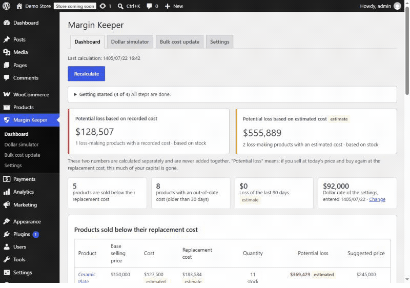
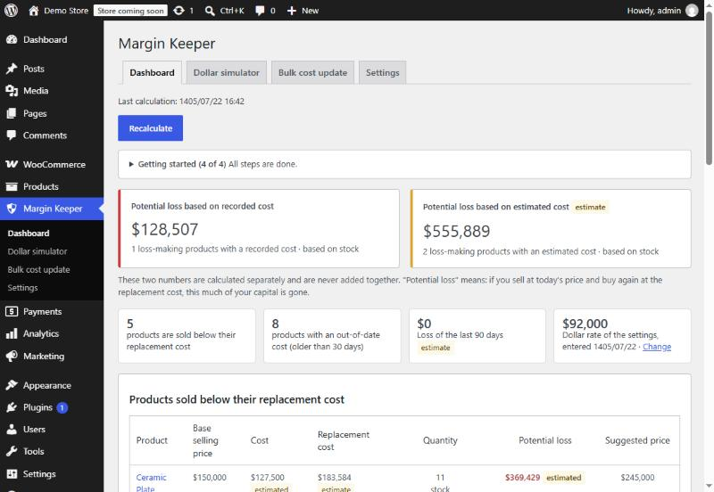
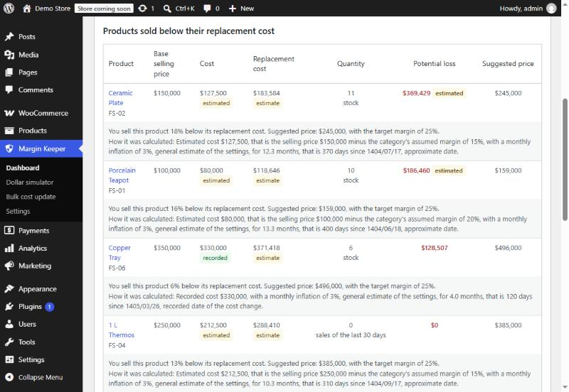
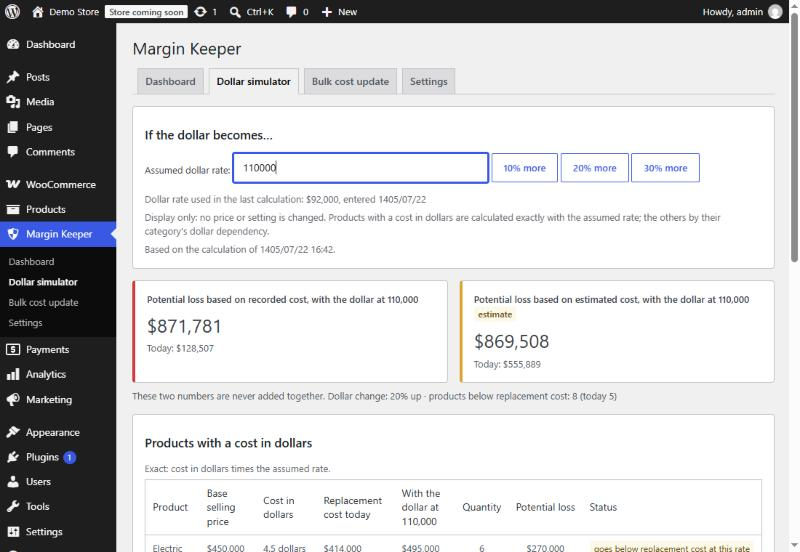
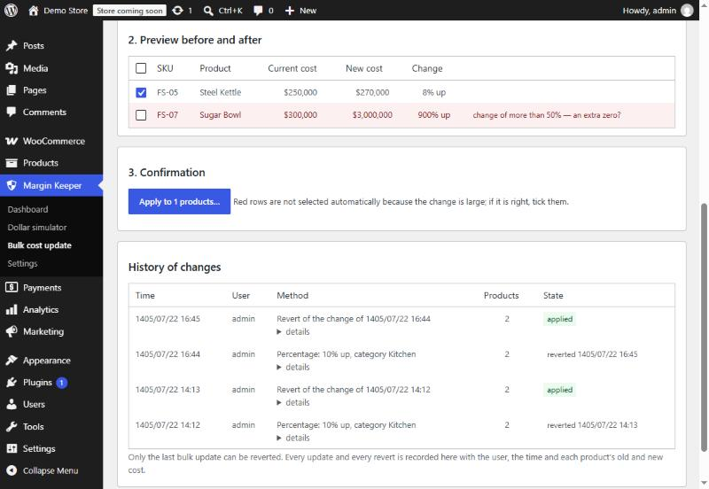
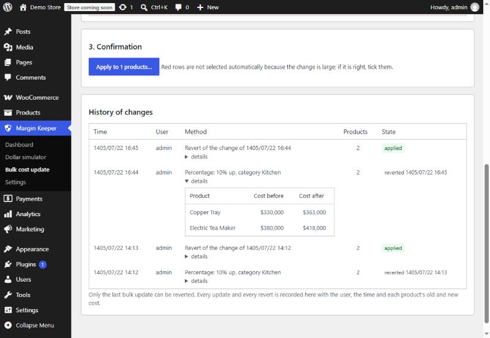
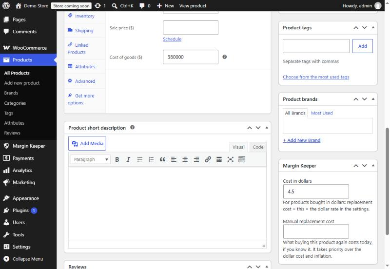

# Margin Keeper («حاشیه‌بان») — Profit Protection for WooCommerce

> **Stop selling below what it costs you to buy again.**
> A WooCommerce plugin for Iranian online stores. It shows, in Toman, how much capital a store is quietly losing when inflation pushes its replacement cost above its selling price.

🇮🇷 **[نسخه‌ی فارسی این سند](README.fa.md)**



**Status:** v1.0.5, release-ready and tested · **Author:** [Shahin Parsa](https://www.linkedin.com/in/shahin-parsa/) · **Source:** private (commercial product). This repository is a showcase: what the product does, how it is built, and how its quality was proven.

---

## The problem

In a high-inflation economy, a store owner bought a product months ago for 85,000 Toman and still sells it for 100,000. It looks like a 15% margin. But buying the same product **today** costs about 107,700 Toman. Every sale shrinks the capital needed to restock, and nothing in WooCommerce shows it.

Most small stores never record purchase costs, so they cannot even calculate this.

## What Margin Keeper does

| Feature | What the store owner gets |
|---|---|
| **Potential-loss dashboard** | Two separate totals, from recorded costs and from estimated costs. They are never added together, so certain and uncertain numbers are never mixed. Products are ranked by potential loss, each with a plain-language "how it was calculated". |
| **Works with zero data** | Enter one "assumed margin" per category and the first number appears in minutes. No purchase cost needs to be recorded first. |
| **Replacement cost, three ways** | Monthly inflation **learned from the store's own cost history** · cost in USD × the dollar rate · a manual value. |
| **"What if the dollar becomes X?" simulator** | Instant what-if in the browser over cached rows. It also shows the dollar rate at which each product starts losing money. |
| **Suggested prices + CSV** | Target margin, rounding step, optional "ends in 9". Display and download only; it never changes prices. |
| **Bulk cost updates** | By percentage, by USD × rate, from a supplier **xlsx/CSV price list** (Persian digits in SKUs and prices), or migrated from three other cost plugins. Always preview → explicit confirmation → audit trail → one-click revert. |
| **90-day profit report** | Loss-making products, totals and cost-data completeness, with Jalali dates. |

<table>
<tr>
<td></td>
<td></td>
</tr>
<tr>
<td align="center"><sub>Dashboard: recorded and estimated losses, never summed</sub></td>
<td align="center"><sub>Every number explains itself</sub></td>
</tr>
<tr>
<td></td>
<td></td>
</tr>
<tr>
<td align="center"><sub>"What if the dollar becomes 110,000?"</sub></td>
<td align="center"><sub>Supplier file: a suspicious 900% change is flagged and left unticked</sub></td>
</tr>
</table>

## Why it is different

Cost-of-goods plugins for WooCommerce (the well-known ones on WordPress.org and the commercial profit reports) answer one question: *"How much did I earn on past orders?"* They subtract a recorded purchase cost from the sale price. In a high-inflation market that answer is comforting and wrong, because the cost that matters is not what you paid, but what you will pay **to buy the product again**.

Margin Keeper is built around that second question. To my knowledge no WooCommerce plugin does the following:

| | Typical cost / profit plugins | Margin Keeper |
|---|---|---|
| **The number it reports** | Past profit on recorded costs | **Future loss of capital** at today's replacement cost, in Toman |
| **A store with no recorded costs** | Shows nothing until every cost is typed in | **Works on day one:** one assumed margin per category yields an estimated cost, clearly labelled, replaced automatically as real costs arrive |
| **Inflation** | Not modelled | **Learned from the store's own cost history:** the median monthly rate of products whose cost changed at least 60 days apart (at least 3 per category), with a transparent fallback and label |
| **"Since when is this cost stale?"** | Not asked | A three-step **base-date resolver:** the plugin's own cost log → the store's sales history (the oldest sale in an unbroken run at the current price, up to 24 months back) → product creation date, each with its own label |
| **Certain vs. estimated numbers** | Mixed into one total | **Two totals that are never added**, on every page and in every export. The word "certain" appears nowhere. |
| **Currency risk** | Nothing, or a fixed exchange rate | A **what-if simulator** that runs in the browser, plus the exact dollar rate at which each product starts losing money |
| **Changing costs in bulk** | Direct writes, no undo | **Preview → explicit confirmation → audit trail → one-click revert**, with a 50% sanity flag, a 12-hour signed preview, and a list of the orders placed between a change and its revert |
| **Honesty of the UI** | Numbers without provenance | Every row carries a **"how it was calculated"** sentence in plain Persian, with no formulas or exponents |

Smaller things that took real care and that store owners in Iran notice immediately:

- **Persian, Arabic and Latin digits are all accepted** in SKUs and prices, so a supplier's Excel file with `KT-۰۶` matches the product `KT-06`.
- **A Jalali calendar implemented in-house** (astronomical algorithm, verified day by day against ICU for the years 1350–1450), so dates stay correct even when a date-conversion plugin is active.
- Prices follow the store's own currency settings (Toman, Rial), with the plugin never converting money.
- It **migrates costs from three other cost plugins** without touching or deleting their data, so switching is painless.

## Engineering highlights

The product is small on the surface and deliberately deep underneath. These are the parts I am proudest of.

**Correctness under failure.** A bulk update is stored as a *fixed plan*: for every product, the cost shown in the preview and the cost to write. A row is written only while its current cost still equals the planned "before" value. If a third-party hook throws after WooCommerce has already saved the product, the retry sees the new value and only adds the missing audit entry. The same plan makes a stale preview from a second browser tab harmless: rows whose cost changed are skipped and named. No "applied twice" scenario survives the test suite.

**Respecting WooCommerce's own semantics.** The plugin reads the raw cost of a variation, not the inherited one, so a revert can restore inheritance (`null`) instead of freezing the parent's old value. Variations whose cost is *additive* to the parent's are left out and named. Before saving, it runs WooCommerce's own validation on the loaded object and refuses any row where a cost-only save would change the stock status, a WooCommerce side effect that would otherwise hide products from the shop. Each of these behaviours was found by reading WooCommerce's source, documented with file and line numbers, and pinned by a test.

**Large stores without timeouts.** Both calculations and bulk writes run as resumable jobs: steps of at most ten seconds, a database lock built the way WordPress core builds its upgrade lock (`INSERT IGNORE`, not the non-atomic `add_option`), progress stored in small options, and a cancel button for jobs left unfinished. The dollar simulator never hits the server: it runs on cached rows in the browser, so 10,000 products simulate instantly.

**A hardened spreadsheet parser with no dependencies.** Supplier files are read with PHP's `ZipArchive` and `XMLReader` only: the first worksheet and the shared-string table, size-counted while streaming (so a forged zip header does not help), DOCTYPE and external entities refused, network access disabled, cells and strings capped before any processing, and a ceiling on the number of cells. The file is read from PHP's temporary upload location and never moved, copied or kept.

**Security as a property, not a checklist.** Every page is gated server-side by capability; every write needs a nonce **and** two capabilities **and** per-product edit rights; inline script data is JSON-encoded with HTML-safe flags; CSV exports neutralise formula injection; SQL is limited to the plugin's own tables through prepared statements. A whole-database fingerprint test proves that viewing, recalculating and every write flow change nothing except cost values and the plugin's own tables. Three adversarial reviews and 95 live attack attempts on a disposable site found no exploitable issue in the release.

**Compatibility you can trust.** One test matrix runs the full suite on the oldest supported stack (PHP 7.4, WordPress 6.7, WooCommerce 10.3) and the newest (PHP 8.3, WordPress 7.1, WooCommerce 11.2), each with both order-storage modes. When WooCommerce 11.2 changed its price markup the day before release, the matrix caught it within hours and the fix shipped the same day.

## Architecture & logic

```
WooCommerce core (products, orders, COGS)          Margin Keeper
──────────────────────────────────────────         ─────────────────────────────────────────────
CRUD API: wc_get_products / wc_get_orders  ──read──▶  Calculation core (pure PHP, unit-tested)
COGS: get_cogs_total_value / set_cogs_value           ├─ base price (tax-exclusive, sale-aware)
product save hooks  ─────────────────────────────▶    ├─ base date: cost log → sales history → creation
                                                      ├─ learned inflation (median, ≥ 3 products)
                                                      └─ replacement cost · potential loss · suggestion
                                                    Batched jobs (AJAX steps ≤ 10 s, DB lock, resumable)
                                                    Own tables: cost log · item data · audit · row cache
                                                    Admin UI: 4 pages, RTL, Jalali, no external assets
                 ◀──write (COGS only, after confirmation, audited, revertible)──
```

- **Built on WooCommerce's core Cost of Goods Sold API** (WooCommerce 10.3+). Every API detail was checked against WooCommerce's source code before use, and the findings are documented with file and line references.
- **Read-heavy, write-minimal:**
  - Viewing and recalculating never write to store data.
  - The only store data the plugin can change is the product cost, through a fixed plan. Each row is written only if its cost still equals the value shown in the preview, so a retry can never apply a change twice.
- **Scales to large catalogs:**
  - Calculations run in resumable batches with a database lock and are cached in the plugin's own table.
  - The simulator runs in the browser.
  - With 10,000 products, no request takes more than 20 seconds.
- **Compatible by design:**
  - High-Performance Order Storage (HPOS) and legacy storage.
  - The Persian ecosystem: a Jalali calendar implemented in-house, independent of date plugins; Persian/Arabic/Latin digits; Toman currency.
- **Private by design:**
  - Zero outgoing HTTP requests.
  - No buyer personal data is read or stored.
  - Uploaded files are parsed in memory and never kept.

## Tech stack

**Runtime**

| Layer | Technology |
|---|---|
| Language | PHP 7.4 → 8.3 (namespaced OOP, PSR-4-style autoloading, typed signatures; PHPStan-clean) |
| Platform | WordPress 6.7 → 7.1 · WooCommerce 10.3 → 11.2, HPOS and legacy order storage, compatibility declared through WooCommerce's `FeaturesUtil` |
| WooCommerce integration | CRUD APIs (`wc_get_products`, `wc_get_orders`, `WC_Product`, `WC_Order_Item_Product`), the core **Cost of Goods Sold** API (`get_cogs_total_value`, `set_cogs_value`), product-save hooks for the cost log; no direct queries on WooCommerce tables |
| Storage | Five plugin tables created with `dbDelta` and a stored schema version (cost log, per-product data, audit header and items, row cache); small autoloaded options for job state and locks |
| Background work | Resumable batched jobs over `admin-ajax`, nonce-protected, with a core-style database lock and a 24-hour stale-job guard |
| Admin UI | Native WordPress admin pages (own top-level menu), RTL CSS, vanilla JavaScript (no jQuery dependency for the plugin's own logic), progress UI, confirmation dialogs |
| File handling | `ZipArchive` + `XMLReader` xlsx reader, CSV with separator detection, BOM handling and Windows-1256 conversion via `iconv`; CSV export streamed in the response |
| Internationalisation | gettext (`.po` / `.mo` / `.l10n.php`), 368 translated strings, Persian digit and separator formatting, in-house Jalali calendar |
| Security primitives | Capability checks, nonces, `wp_kses` allow-lists, HTML-safe `wp_json_encode` flags, `$wpdb->prepare` with `%i` identifiers, upload validation by extension **and** content |

**Engineering & quality toolchain**

| Purpose | Tooling |
|---|---|
| Tests | PHPUnit on the WordPress test library with real WooCommerce (no mocks of the behaviour under test); a WooCommerce-inactive suite; a Node.js harness that runs the browser simulator's JavaScript against the same data |
| Static analysis | PHPCS with WordPress Coding Standards and PHPCompatibility · PHPStan · Psalm taint analysis · WordPress Plugin Check |
| Performance | A 10,000-product, 300-order fixture built on every release; every request asserted under 20 s |
| Release | A single reproducible build script: all checks → `git archive` of the tagged commit minus development files → scan for forbidden files → fresh WordPress + WooCommerce install, activate, open, deactivate, uninstall (oldest and newest stack) → Plugin Check on the zip → signed tag |
| Environment | Private MySQL 8.4 and PHP 7.4/8.3 builds, WP-CLI, downloads verified against official checksums; Git with per-task branches and reviewed pull requests |
| Process | A written specification with 46 numbered requirements and acceptance criteria, golden test data with hand-computed answers, a decision log, a risk register, and a Persian report after every task |

## How quality was proven

| | |
|---|---|
| **Automated tests** | **276 tests** in a 4-way matrix (PHP 7.4 / 8.3 × oldest / latest WordPress and WooCommerce × HPOS / legacy), plus a WooCommerce-inactive suite |
| **Golden data** | A seeded test store with **hand-computed expected answers**. Tests assert the exact Toman values, e.g. 1,123,395 and 1,072,245. |
| **Performance** | 10,000-product test on every build. Slowest request: 14.6 s (limit 20 s). |
| **Write-scope proof** | Whole-database fingerprint before and after every write flow. Only cost values and the plugin's own tables may change. |
| **Security** | Three independent adversarial reviews. 95 live attack attempts on a test site (role escalation, CSRF, stored XSS, CSV injection, XXE, zip bombs, zip slip), all blocked. Static taint analysis. Every exploitable finding fixed before release. |
| **Release build** | One command: all checks → package from the tagged commit → scan for development files → real install, activation and uninstall on a brand-new WordPress (oldest and latest) → Plugin Check on the zip |
| **Acceptance** | Screenshot-based acceptance against the specification, plus a full functional test in the browser as a real store owner |

 

## How it was built (my role)

I am the **product owner and lead** of Margin Keeper. My work:

- **Defined the product:** market research on Iranian WooCommerce stores, the product vision, a decision log (D-xxx) and a risk register (R-xx).
- **Wrote and approved the specifications:** 46 numbered requirements (REQ-xxx), each with acceptance criteria and test data with known answers.
- **Directed the implementation through AI-assisted development:** I used an AI coding agent (Claude Code) and set strict guardrails:
  - one task at a time;
  - no "done" without passing tests and static analysis;
  - every WooCommerce API verified in source before use;
  - a write scope enforced by tests;
  - a human-readable report for every task.
- **Ran acceptance and quality gates:** screenshot acceptance against the spec, red-team reviews, and release decisions.

The result: about 12,400 lines of production code and 11,500 lines of tests in 124 reviewed commits. Every behaviour is traceable to a requirement ID.

## Demo & proof

The source code is private because Margin Keeper is a commercial product. To see it working:

- **Screenshots and animation:** [`assets/en/`](assets/en/) (English admin) and [`assets/fa/`](assets/fa/) (the Persian admin, which is what the product ships for). All were taken from seeded demo stores; product names and numbers are fictional. The English demo store is set to US dollars so the symbol is readable; the plugin itself shows whatever currency the store uses (Toman for its real customers) and converts nothing.
- **Documents:** [`docs/`](docs/) holds the Persian user guide and FAQ, and [`quality-evidence.en.md`](docs/quality-evidence.en.md), an English summary of the test, performance and security evidence.
- **Live demo or walkthrough:** message me on [LinkedIn](https://www.linkedin.com/in/shahin-parsa/) or Telegram ([@S3DEngineerP](https://t.me/S3DEngineerP)) and I will share a screen session or a recorded walkthrough.

## Author & contact

**Shahin Parsa**, product owner and developer of Margin Keeper.

- LinkedIn: [linkedin.com/in/shahin-parsa](https://www.linkedin.com/in/shahin-parsa/)
- Telegram: [@S3DEngineerP](https://t.me/S3DEngineerP)

## License

This showcase repository (README and images) is released under the [MIT License](LICENSE). The Margin Keeper plugin itself is a commercial product; its source code is not included here.
